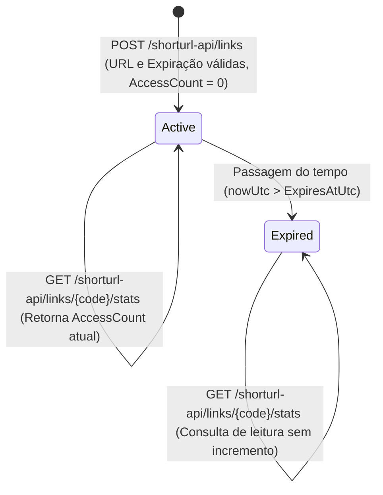

# Data Model: Encurtador de Links (ShortURL)

**Feature Branch**: `001-url-shortener`
**Date**: 2026-10-16
**References**: [spec.md](./spec.md) | [research.md](./research.md)

## 1. Visão Geral do Agregado

O domínio possui uma única entidade raiz de agregado: **`ShortLink`** (representando o modelo `Link` do plano técnico), localizada em `src/Domain/Entities/ShortLink.cs`, sem dependências externas conforme o **Princípio I da Constituição**.

> **Nota sobre Adaptação à Spec (`FR-003`, `FR-005`, `FR-008`)**:
> - O campo `ExpiresAtUtc` **não é nulo** (`NOT NULL`): quando não informado pelo criador, assume `CreatedAtUtc.AddYears(10)` (**FR-005**).
> - Não há coluna `ManagementKeyHash` nem suporte a `custom alias` no banco: a geração do código é 100% automática (**FR-003** / **FR-004**) e a consulta de acessos é pública por código (**FR-008**).

---

## 2. Entidade: `ShortLink`

| Propriedade | Tipo C# (.NET 10) | Tipo SQLite | Nulável | Restrições / Índices | Descrição |
|-------------|-------------------|-------------|---------|----------------------|-----------|
| `Id` | `long` | `INTEGER` | Não | `PRIMARY KEY AUTOINCREMENT` | Identificador numérico sequencial único (`1..N`), usado como semente para a bijeção Base62/Hashids (**FR-004**). |
| `Code` | `string` | `TEXT` | Não | `MAX LENGTH(7)`, `FIXED LENGTH(7)`, `UNIQUE INDEX IX_ShortLinks_Code` | Código curto único de exatos 7 caracteres no alfabeto Base62 (`[0-9A-Za-z]{7}`) (**FR-003**). |
| `TargetUrl` | `string` | `TEXT` | Não | `MAX LENGTH(2048)` | URL original de destino com esquema `http` ou `https` e host público válido (**FR-002**). |
| `CreatedAtUtc` | `DateTime` | `TEXT` (ISO-8601 UTC) | Não | - | Data e hora exata de criação do link em UTC (**FR-009**). |
| `ExpiresAtUtc` | `DateTime` | `TEXT` (ISO-8601 UTC) | Não | `INDEX IX_ShortLinks_ExpiresAtUtc` (opcional para manutenção futura) | Instante limite de validade em UTC (`23:59:59.9999999Z` da data informada ou `CreatedAtUtc + 10 anos`) (**FR-005**). |
| `AccessCount` | `long` | `INTEGER` | Não | `DEFAULT 0`, `CHECK (AccessCount >= 0)` | Contador inteiro monotônico crescente de redirecionamentos válidos (**FR-007**). |

---

## 3. Regras de Validação e Invariantes de Domínio

### 3.1. Na Criação (`CreateShortLinkCommand` / `ShortLink`)
1. **`TargetUrl` (FR-001, FR-002 / RN-02)**:
   - Obrigatória, não vazia e com comprimento $\le 2048$ caracteres.
   - Deve ser uma URI absoluta válida (`UriKind.Absolute`) com esquema estritamente `http` ou `https`.
   - O `Host` deve ser público:
     - Rejeitar `localhost` e sufixos reservados locais (`.local`, `.internal`, `.localhost`).
     - Se o host for um endereço IP (IPv4 ou IPv6), rejeitar:
       - Loopback (`127.0.0.0/8`, `::1`)
       - Redes privadas RFC 1918 (`10.0.0.0/8`, `172.16.0.0/12`, `192.168.0.0/16`)
       - Link-local (`169.254.0.0/16`, `fe80::/10`)
       - Unique Local IPv6 (`fc00::/7`)
       - Endereços não especificados (`0.0.0.0`, `::`)
2. **`ExpiresAtUtc` (FR-005 / RF-06 / RN-03)**:
   - Se omitido (`null` no payload de entrada): `ExpiresAtUtc = CreatedAtUtc.AddYears(10)`.
   - Se informado: o valor normalizado para o fim do dia em UTC (`YYYY-MM-DDT23:59:59.9999999Z`) deve ser estritamente futuro em relação ao instante atual (` nowUtc `), sendo recusadas datas passadas em UTC com mensagem em português.
3. **`Code` (FR-003, FR-004 / RN-01, RN-05)**:
   - Nunca recebido na entrada do usuário (*custom alias* fora de escopo).
   - Sempre calculado deterministicamente a partir de `Id` via `IShortCodeGenerator.Encode(id)`, resultando em exatos 7 caracteres Base62 (`^[0-9A-Za-z]{7}$`).
4. **`AccessCount` (FR-007 / RN-04)**:
   - Inicializado obrigatoriamente em `0`.

### 3.2. No Redirecionamento e Consulta (`ResolveShortLinkCommand` / `GetShortLinkStatsQuery`)
1. **Formato do `{code}`**:
   - Deve conter entre 1 e 7 caracteres alfanuméricos Base62 (`^[0-9A-Za-z]{1,7}$`). Códigos fora do padrão ou com comprimento diferente de 7 para links gerados pelo sistema resultam em `ShortLinkNotFoundException` (`404 Not Found`) ou erro de validação (`400 Bad Request`).
2. **Existência (`RN-01`)**:
   - Se não existir registro correspondente ao `Code`, lança `ShortLinkNotFoundException` (`404 Not Found` com `ProblemDetails` em português).
3. **Vigência (`RN-03`)**:
   - Um link está ativo se e somente se `nowUtc <= ExpiresAtUtc`.
   - Em tentativas de redirecionamento (`GET /{code}`) quando `nowUtc > ExpiresAtUtc`, lança `ShortLinkExpiredException` (`410 Gone` com `ProblemDetails` em português) e **não incrementa** `AccessCount`.
4. **Incremento Atômico (`RN-04`)**:
   - Executado via `UPDATE` atômico no banco (`SET AccessCount = AccessCount + 1 WHERE Id = @id AND ExpiresAtUtc >= @nowUtc`).

---

## 4. Ciclo de Vida e Transições de Estado

---

## 5. Dimensionamento e Armazenamento (FR-010 / CE-01..CE-04)

- **Tamanho médio estimado por registro**:
  - `Id` (8 bytes) + `Code` (7 bytes) + `TargetUrl` (~100 bytes médios conforme RF-09) + `CreatedAtUtc` (8-27 bytes) + `ExpiresAtUtc` (8-27 bytes) + `AccessCount` (8 bytes) $\approx 140\text{–}175\text{ bytes}$ brutos (~100 bytes de payload útil de URL).
- **Volume em 10 anos**:
  - $100.000.000\text{ URLs/dia} \times 365\text{ dias} \times 10\text{ anos} = 365.000.000.000\text{ registros}$ (~36,5 TB de URLs).
- **Espaço de Chaves Base62 (7 caracteres)**:
  - $62^7 = 3.521.614.606.208$ combinações únicas (~9,65x o volume total de 10 anos), garantindo ausência matemática de colisão por bijeção sobre `Id`.

